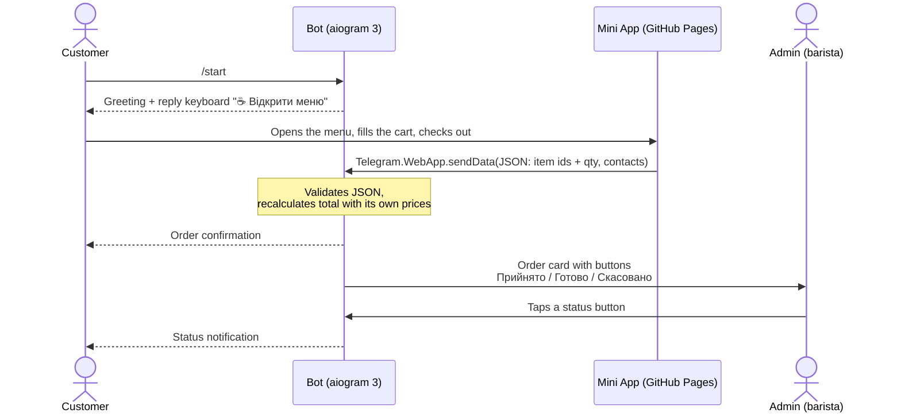
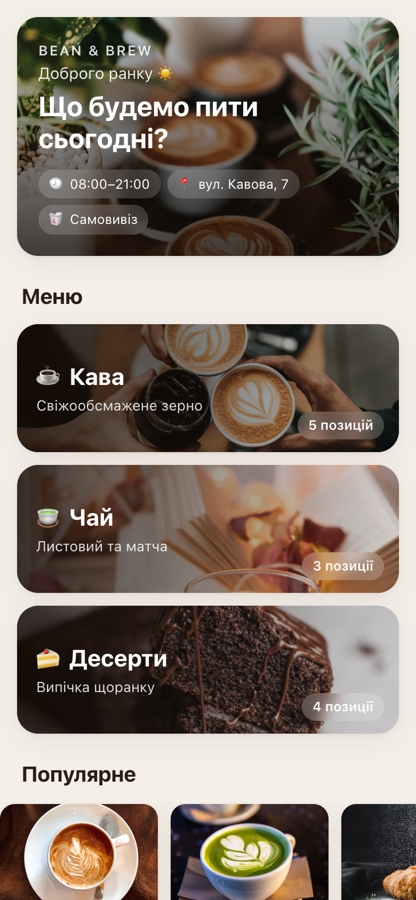
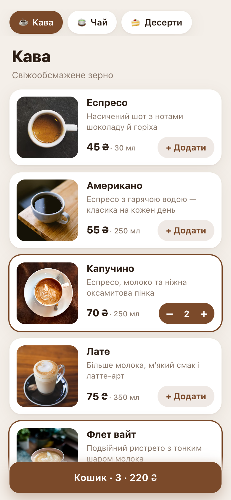
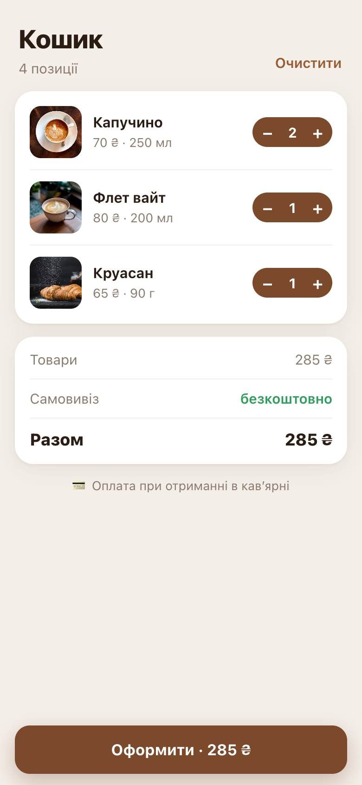
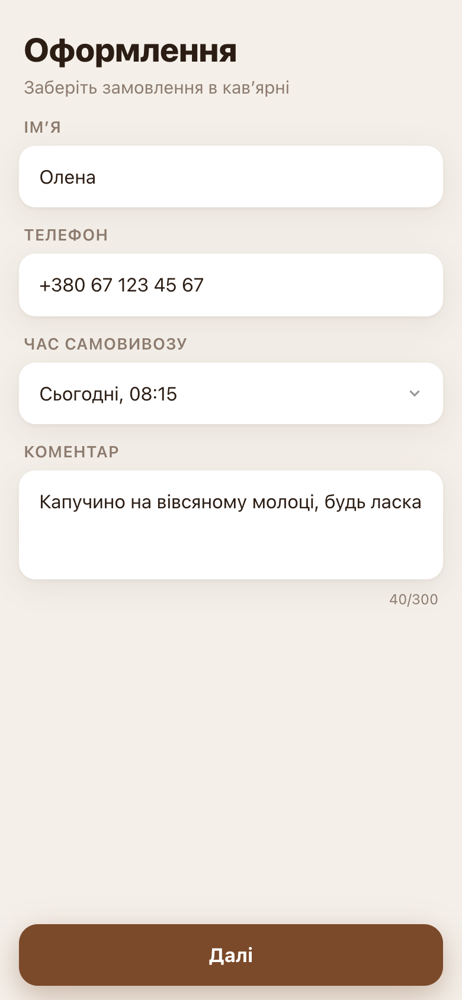
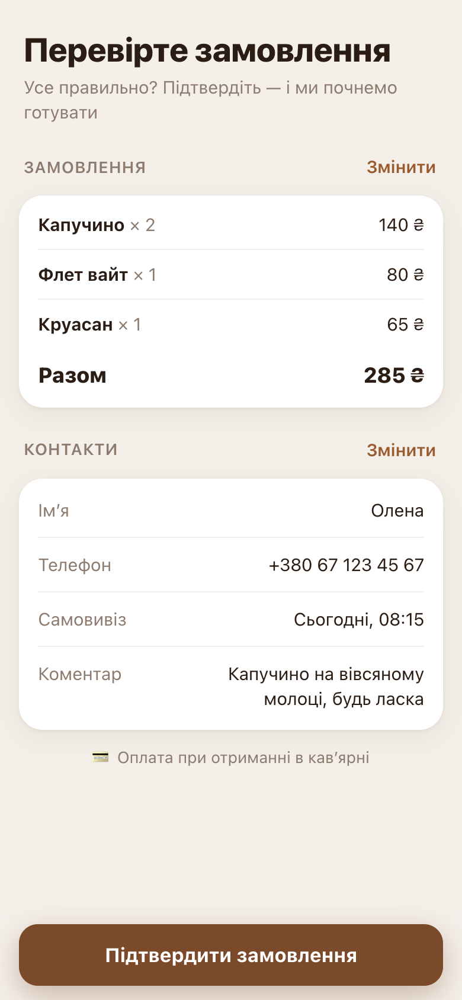
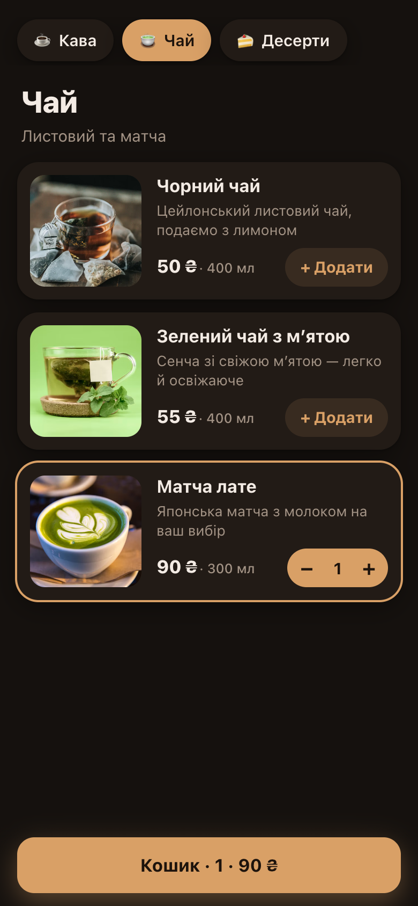

# ☕ Bean & Brew — Telegram Mini App for a coffee shop

A demo **Telegram Mini App** for ordering coffee, tea and desserts for pickup, plus a **Python bot** that receives orders, re-checks prices and lets the barista update the order status. Built as a portfolio project.

## Live demo

- 🌐 **Mini App (opens in any browser in demo mode):** https://blessedrbls.github.io/coffee-miniapp/
- 🤖 **Telegram bot:** [@coffee_miniapp_bot_bot](https://t.me/coffee_miniapp_bot_bot) — press **/start**, then **☕ Відкрити меню**

> The bot runs on the author's machine, so it may be offline at times. The website demo is always available.

## How it works



1. The customer opens the Mini App from the **reply keyboard button** (required for `sendData` to work).
2. The Mini App sends only **product ids, quantities and contact details** — never trusted prices.
3. The bot validates every field, **recalculates the total from its own price list** and stores the order in SQLite.
4. Admins get an order card with status buttons; every status change edits the card for all admins and notifies the customer in their language.

## Features

**Mini App**
- Screens: categories → product list with photos and +/− buttons → cart → checkout (name, phone, pickup time, comment) → confirmation
- Uses Telegram theme colors (`themeParams`), light and dark mode, live theme switching
- Native Telegram **MainButton** and **BackButton**, **haptic feedback** when adding to cart
- Ukrainian 🇺🇦 and English 🇬🇧, picked from the user's Telegram language
- Smooth screen transitions, mobile-first layout, cart saved between sessions
- Pickup time slots based on opening hours, form validation, XSS-safe output
- **Demo mode** when opened outside Telegram: in-page main/back buttons, language and theme toggles

**Bot**
- `/start` with a reply keyboard `web_app` button, `/myid` to find your Telegram ID
- Strict validation of `web_app_data` (known items, quantity limits, phone, time, text length)
- Server-side price calculation; flags orders where the Mini App total did not match
- Admin order cards with **Прийнято / Готово / Скасовано**, allowed status transitions only, safe for several admins
- Customer notifications on every status change, in Ukrainian or English
- Orders stored in SQLite, so buttons keep working after a restart

## Screenshots

| Menu | Product list | Cart |
|:---:|:---:|:---:|
|  |  |  |

| Checkout | Order review | Dark theme |
|:---:|:---:|:---:|
|  |  |  |

<!-- Admin order card in Telegram: add docs/screenshots/07-admin-card.png and a row here -->
_Admin order card in Telegram — screenshot coming soon._

## Tech stack

- **Mini App:** HTML, CSS, vanilla JavaScript (no frameworks), [Telegram Web Apps API](https://core.telegram.org/bots/webapps)
- **Bot:** Python 3.11+, [aiogram 3](https://docs.aiogram.dev/), python-dotenv, SQLite
- **Hosting:** GitHub Pages (Mini App)

## Project structure

```
coffee-miniapp/
├── webapp/              # Mini App (static site)
│   ├── index.html
│   ├── style.css
│   ├── app.js           # screens, cart, Telegram API, demo mode
│   └── products.js      # demo menu (12 items)
└── bot/                 # Telegram bot
    ├── main.py          # entry point
    ├── config.py        # reads .env
    ├── menu.py          # price list — the source of truth
    ├── orders.py        # order validation and message formatting
    ├── db.py            # SQLite storage
    ├── keyboards.py
    ├── texts.py         # UA / EN texts
    ├── handlers/        # /start, web_app_data, status buttons
    ├── requirements.txt
    └── .env.example
```

## Deploy the Mini App to GitHub Pages

Telegram only opens Mini Apps over **HTTPS**, and GitHub Pages gives you that for free.

1. Fork or push this repository to GitHub.
2. Publish the `webapp/` folder to the `gh-pages` branch:
   ```bash
   git subtree push --prefix webapp origin gh-pages
   ```
3. On GitHub, open **Settings → Pages → Build and deployment** and choose **Deploy from a branch**, branch **`gh-pages`**, folder **`/ (root)`**.
4. After a minute the app is live at `https://<your-username>.github.io/coffee-miniapp/`.
5. Run the same `git subtree push` command after every change in `webapp/`.

### Connect the URL to the bot

- **In `.env`:** set `WEBAPP_URL=https://<your-username>.github.io/coffee-miniapp/` — the bot uses it for the reply keyboard button.
- **In @BotFather** (optional menu button): `/mybots` → your bot → **Bot Settings** → **Menu Button** → send the same URL → send a title, e.g. `Menu`.

> ⚠️ A Mini App opened from the **menu button** can browse the menu, but Telegram only allows `sendData` from a **reply keyboard button**. To place an order, use **☕ Відкрити меню** below the message field.

## Run the bot

```bash
cd bot
python3 -m venv .venv
source .venv/bin/activate
pip install -r requirements.txt
cp .env.example .env
```

Fill in `.env`:

| Variable | Description |
|---|---|
| `BOT_TOKEN` | Token from [@BotFather](https://t.me/BotFather) |
| `ADMIN_IDS` | Comma-separated Telegram IDs of admins (send `/myid` to the bot to find yours) |
| `WEBAPP_URL` | HTTPS address of the Mini App |

Start it:

```bash
python main.py
```

The bot uses long polling, so no server or domain is needed for local runs.

## Try the Mini App locally

```bash
python3 -m http.server 8000 --directory webapp
```

Open http://localhost:8000 — outside Telegram the app runs in demo mode, and the order JSON that would be sent to the bot is printed to the browser console.

## Photo credits

All product photos are from [Unsplash](https://unsplash.com) and used under the free [Unsplash License](https://unsplash.com/license):

| Used for | Source |
|---|---|
| Hero | [photo-1509042239860-f550ce710b93](https://images.unsplash.com/photo-1509042239860-f550ce710b93) |
| Coffee category | [photo-1495474472287-4d71bcdd2085](https://images.unsplash.com/photo-1495474472287-4d71bcdd2085) |
| Tea category | [photo-1594631252845-29fc4cc8cde9](https://images.unsplash.com/photo-1594631252845-29fc4cc8cde9) |
| Desserts category | [photo-1606313564200-e75d5e30476c](https://images.unsplash.com/photo-1606313564200-e75d5e30476c) |
| Espresso | [photo-1510591509098-f4fdc6d0ff04](https://images.unsplash.com/photo-1510591509098-f4fdc6d0ff04) |
| Americano | [photo-1551030173-122aabc4489c](https://images.unsplash.com/photo-1551030173-122aabc4489c) |
| Cappuccino | [photo-1572442388796-11668a67e53d](https://images.unsplash.com/photo-1572442388796-11668a67e53d) |
| Latte | [photo-1561882468-9110e03e0f78](https://images.unsplash.com/photo-1561882468-9110e03e0f78) |
| Flat White | [photo-1577968897966-3d4325b36b61](https://images.unsplash.com/photo-1577968897966-3d4325b36b61) |
| Black Tea | [photo-1576092768241-dec231879fc3](https://images.unsplash.com/photo-1576092768241-dec231879fc3) |
| Green Tea with Mint | [photo-1627435601361-ec25f5b1d0e5](https://images.unsplash.com/photo-1627435601361-ec25f5b1d0e5) |
| Matcha Latte | [photo-1515823064-d6e0c04616a7](https://images.unsplash.com/photo-1515823064-d6e0c04616a7) |
| Croissant | [photo-1555507036-ab1f4038808a](https://images.unsplash.com/photo-1555507036-ab1f4038808a) |
| Blueberry Cheesecake | [photo-1533134242443-d4fd215305ad](https://images.unsplash.com/photo-1533134242443-d4fd215305ad) |
| Chocolate Cake | [photo-1578985545062-69928b1d9587](https://images.unsplash.com/photo-1578985545062-69928b1d9587) |
| Macarons | [photo-1569864358642-9d1684040f43](https://images.unsplash.com/photo-1569864358642-9d1684040f43) |

The coffee shop "Bean & Brew", its address and menu are fictional.

---

**Need a Telegram Mini App like this? Contact me on Telegram: [@nonelyyo](https://t.me/nonelyyo)**
